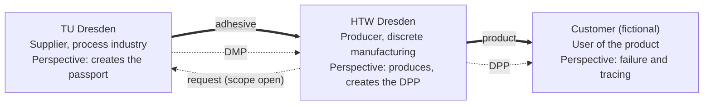
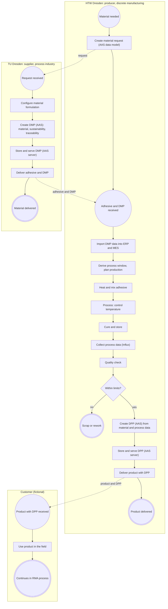

# Forward chain: institutions, value chain and procurement process

Status: draft v0.3 (2026-10-27)
Block: 1 Procurement (forward chain), see `main-document.md`
Origin tags: [Task], [Slides], [05.10.], [14.10.], [Derived], as defined in `main-document.md`. Quote IDs (T4, G4b and so on) refer to `task-decomposition.md`.

## 1. What the forward chain is

The forward chain is the normal operation of the supply chain before any failure occurs. It covers three things: the supplier provides a material with a passport (DMP), the producer buys the material, uses its data to run production, and the producer delivers a product with its own passport (DPP) to the customer.

Terms: "forward chain" and "reverse chain" are working names of this project. They descipe the flow of information along or against the supply chain.

## 2. The three institutions

The three perspectives come from the 14.10. notes: TU leads to the DPP, HTW to production with the new HTW DPP, and the customer to the failure and tracing. [14.10.]

Legend: thick arrows are the material flow, dotted arrows are information flows.

| Institution | Role | Domain | Real or simulated | Origin |
|---|---|---|---|---|
| TU Dresden (Prof. Leon Urbas) | Supplier of the adhesive and its passport | Process industry (chemistry) | Real partner, asked for data (no answer yet). The task says the process industry is simulated in software | [Slides], [14.10.], [Task G4b] |
| HTW Dresden | Producer, last producer in the chain | Discrete manufacturing | Real institution with a testbed. Production equipment is simulated (Jumi handling unit, oven) | [Slides], [14.10.] |
| Customer | User of the HTW product, source of the failure | Not specified | Fictional | [14.10.] |

Notes:

- HTW is the last producer, and before HTW there is "eigentlich nur die TU". HTW may possibly also produce for a further producer. [14.10.]
- Which product HTW makes with the adhesive is not defined anywhere in the sources. It is part of "find a story" (14.10.) and listed under open points.

## 3. The value chain

The chain is a supply chain (Lieferkette) of three stages. The task calls it "Wertschöpfungskette" [Task T3].

Model scope: a linear chain of three institutions. The task speaks more generally of "Wertschöpfungsnetzwerken". [Task G6]

### What each stage adds

| Stage | Institution | Value added | Material in, out | Information in, out |
|---|---|---|---|---|
| 1 | TU Dresden | Configures a material with defined technical and qualitative properties, and documents origin, sustainability and traceability [Task T4, T6] | raw materials (not modeled), adhesive | request, DMP |
| 2 | HTW Dresden | Uses the adhesive in a production process within material-defined limits and builds the product [Task T9, T10] | adhesive, product | DMP, then process data, then DPP |
| 3 | Customer | Uses the product, where the value is realized | product, none | DPP (and, in a failure, the tracing) |

### The flows along the chain

| Flow | Direction | Origin |
|---|---|---|
| Material (adhesive, then product) | Downstream, TU to HTW to customer | [Task T4, T6], [Derived] |
| Request for the material | Upstream, HTW to TU. Whether it is part of the demonstrator is open | [Task T5] |
| Passports (DMP, then DPP) | Downstream, with the material | [Task T6], [Slides] |
| Process data | Inside HTW, from the simulated production into the DPP | [Slides] |
| Money, orders, contracts | Not modeled. No source mentions them | [Derived] |

Out of the model: suppliers before TU, and the use after the customer (recycling and reuse appear only as data in the passport, [Task T8]). The 14.10. notes confirm that earlier stages exist: if no fault is in the TU data, the answer refers to the earlier supply chain.

### What the passports contain

| Passport | Created by | Content | Origin |
|---|---|---|---|
| DMP | TU | "Material-, Nachhaltigkeits- und Rückverfolgbarkeitsinformationen"; material-dependent limits such as processing temperature, cure time, humidity, storage and safety requirements; circular-economy data (open) | [Task T6, T8, T10] |
| DPP | HTW | Created "aus den Daten und Prozessinformationen" of the production. Likely content: product ID, material lot reference, process parameters with timestamps, quality result | [Slides], [Derived] |

The DPPs are not coupled or linked. [14.10.] A link between the DMP and the DPP therefore needs shared identifiers, such as the adhesive lot ID. [Derived]

## 4. The procurement and production process (BPMN Style)

### Step origins

| Step | Origin |
|---|---|
| H1, H2, T1: material need and digital request as AAS data model | [Task T4, T5] |
| T2, T3, T5: configure the material, create the DMP, deliver | [Task T6] |
| T4, H12: store and serve passports on an AAS server | [Derived]: the AAS is a transport standard, not storage ([Slides]) |
| H4, H5: import material parameters into ERP and MES, derive the process window | [Task T9, T10, T10a, G4a] |
| H6, H7, H8: heating and mixing before, temperature during processing, curing and storage afterwards | [14.10.] |
| H9: process data in the Influx database | [Slides]. Shown as one step for readability, in reality data is recorded during production |
| H10, G1, X1: quality check with a scrap-or-sellable decision | [Derived]. Based on the 14.10. question "Warum wird das nicht vorher herausgefiltert?" and the quality processes in [Task G4a] |
| H11: new DPP from data and process information | [Slides] |
| H13, K1, K2: delivery and use at the customer | [Derived] |
| K3: link to the reverse chain | [14.10.] |

The quality gateway matters for the failure story. A deviation that stays within limits passes the check and can still cause a field failure later. [Derived from 14.10.]
