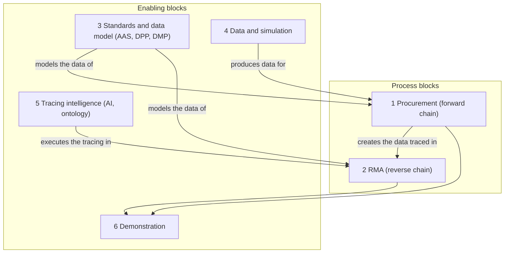

# AAS cross-domain supply chain demonstrator: entry document

Status: draft v0.1 (2026-10-27)
Project: Projektseminar WS 2026/2027, HTW Dresden, Professur für Informationsmanagement (Prof. Dr. Dirk Reichelt)

## 1. Purpose and how to use this document

This File is supposed to be the entry into this project providing a already differientiated understanding of the task ahead by reframeing it based on already gained knowledge and Answered Questions.

## 2. The project in one paragraph

The project builds a demonstrator for a semi-fictional cross-domain supply chain: TU Dresden as process-industry supplier of an adhesive, HTW Dresden as discrete-manufacturing producer, and a fictional customer who uses the HTW product. Material and product information travels along the chain as AAS-based passports (DMP from the supplier, DPP from the producer). The showcase use case is a field failure at the customer: an AI chatbot with ontologies uses the passport data to trace the failure back through the chain, in the style of an RMA process. The demonstrator is meant to show that AAS-based passports deliver interoperability, transparency and automation across domains. [Task T1 to T3, G6; Slides; 14.10.]

## 3. The six Subtasks

Subtask Relationship Diagram

| # | Subtask | Source | Detail file |
|---|---|---|---|
| 1 | Procurement (forward chain) | Explicit | `forward-chain-process.md` |
| 2 | RMA (reverse chain) | None, comes from slides and meetings | `rma-reference-process.md` |
| 3 | Standards and data model | Explicit | |
| 4 | Data and simulation | Partial | |
| 5 | Tracing intelligence | None, comes from slides and meetings | |
| 6 | Demonstration | Explicit | |

## 4. Process blocks

### Block 1: Procurement (forward chain)

Goal: show normal operation, before any failure. A material request leads to a DMP, the DMP data drives ERP and MES parameters at HTW, HTW produces, and creates a new DPP from material and process data. This creates the data that block 2 later traces.

Explicit requirements:

| Requirement | Origin |
|---|---|
| A manufacturer needs a material (example: adhesive) with defined technical and qualitative properties | [Task T4] |
| The requirement goes as a digital request based on an AAS data model to the process-industry manufacturer | [Task T5] |
| The supplier configures the material and delivers it with material, sustainability and traceability information in a DMP | [Task T6] |
| Material data (for example processing temperature, cure time, humidity, storage, safety) flows into ERP and MES and is used along the production process | [Task T9, T10, T10a, G4a] |
| HTW receives and processes the DPP and creates a new DPP from the data and process information | [Slides] |
| Steps of adhesive processing: before (heating, mixing), processing (temperature), afterwards (curing, storage) | [14.10.] |

Implicit tasks:

- Decide which adhesive data is relevant, and what has to happen before, during and after processing. [14.10.: "Gedanken machen welche Daten relevant sind"]
- Map DMP properties to process windows and DPP submodels. [Derived]
- Run an AAS server or repository that stores and serves the passports [Slides, Derived]

Decisions: HTW is the last producer in the chain. Implement medium complexity, show higher complexity in the outlook. [14.10.]

Open points: is the request step part of the demonstrator (Q2)? Which AAS type connects the parties (Q4)? What if the TU data does not arrive (Q6)?

### Block 2: RMA (reverse chain)

Goal: show that a field failure at the customer can be traced back through the passports to a cause in the process or the material. The generic reference process and the scope on it are in `rma-reference-process.md`.

Requirements and decisions (all from slides and meetings, none from the written task):

| Statement | Origin |
|---|---|
| Assumption: an error occurred at the customer | [14.10.] |
| Tracing: does a deviation in temperature lead to scrap, or is the product still sellable? Why is it not filtered out earlier? | [14.10.] |
| Find a story for the scenario | [14.10.] |
| The communication between HTW and the customer is left out. The customer works directly on the data with the AI (RMA process) | [14.10.] |
| The DPPs are not coupled or linked | [14.10.] |
| If no fault is found in the TU data, the answer refers to an error in the earlier supply chain (as understood from the note) | [14.10.] |
| HTW possibly produces for a further producer | [14.10.] |
| The producer side includes "Traceability herstellen" as one of its tasks | [Slides] |

Implicit tasks:

- Write the story: failure, affected product, trigger, the expected finding. [14.10., Derived]
- Define the tracing as two queries: backward from a failed unit to its inputs, process runs and material lots, and forward from a suspect lot to all affected units. [Derived]
- Link the tiers by shared identifiers such as lot IDs, because DPPs are not coupled. [Derived from 14.10.]

Open points: does the demonstrator model the failure-analysis result as data (Q8)? Validate the reference process with a practitioner (Q9).

## 5. Enabling blocks

### Block 3: Standards and data model (AAS, DPP, DMP)

Goal: represent products, materials and information flows in a standardized, interoperable way, and provide the communication infrastructure. This block decides how blocks 1 and 2 represent their data.

Explicit requirements:

| Requirement | Origin |
|---|---|
| Continuous use of the AAS as standardized representation of products (DPP), materials (DMP) and information flows | [Task T3] |
| Information exchange via AAS data models and standardized interfaces, interoperable, traceable and machine-readable | [Task T7] |
| Circular-economy information: origin, raw materials, CO2 footprint, recyclability, reuse and recovery options | [Task T8] |
| Design AAS-based information models for material requests, DMP, DPP and production, quality and sustainability information | [Task G2] |
| Implement an AAS-based communication infrastructure between the systems along the supply chain | [Task G3] |
| Reuse existing templates (ECLASS, IDTA submodels), harmonize wording | [Slides] |
| Guidance: each submodel template is an independent unit, any information can be shared down to a single value, think of the target system (complex structures are slow to ingest), solve your own problem first and abstract afterwards | [Slides] |
| AAS types: type 1 exchange of copies, type 2 defined interfaces such as REST, type 3 autonomous queries | [Slides] |
| Tools named: AAS Package Explorer, IDTA AASX Server, BaSyx, FA³ST | [Slides] |

Implicit tasks: fix the terms in the glossary. Choose existing IDTA submodels or custom ones per data object. Choose the AAS type and the runtime. Define the identifiers that link the passports. [Derived]

Open points: AAS type and runtime (Q4), circular-economy data in scope (Q3), submodel set.

### Block 4: Data and simulation

Goal: produce the data that the other blocks work on, including a failure case with a known cause.

Explicit requirements:

| Requirement | Origin |
|---|---|
| The process industry is simulated in software and provides material and product information via AAS-conforming interfaces | [Task G4b] |
| Exemplary plant, ERP and MES functionality on the discrete-manufacturing side | [Task G4a] |
| Jumi as handling unit (possibly as simulation), the oven faked (too long, too short, too hot, too cold), data stack with Influx and SAP OData | [Slides] |
| Which data has to be mocked? Adhesive data. Where does the data come from? | [14.10., 05.10.] |
| Simulate the process and generate fault cases with a standard deviation | [14.10.] |
| Paul asked TU for data, no answer yet | [14.10.] |

Implicit tasks: decide in advance which deviation causes the field failure, so the AI has something findable. Add harmless deviations as decoys, to cover "scrap or still sellable". Make the simulation reproducible, so that tests can be repeated. [Derived]

Open points: when does TU data arrive and what is the fallback (Q6)? Which deviation is the cause in the story (Q7)?

### Block 5: Tracing intelligence (AI, ontology)

Goal: let the customer find the cause of a failure by asking questions on the passport data.

Explicit requirements:

| Requirement | Origin |
|---|---|
| Idea: traceability with the help of an AI chatbot and ontologies. Technology focus areas: AI, ontologies, AAS, SAP OData | [Slides] |
| Is an MCP enough? Connection to external services. Trace the process chain back. Data for the troubleshooting | [05.10.] |
| The customer can work directly on the data with the AI | [14.10.] |

Implicit tasks: design the ontology (lot, process step, parameter, material property, defect and their relations). Decide how the AI reads the AAS data. Define how an answer is checked against the known cause from block 4. [Derived]

Open points: MCP or more (Q5), ontology scope.

### Block 6: Demonstration

Goal: make the information flow visible and show the benefit.

Explicit requirements:

| Requirement | Origin |
|---|---|
| Visualize and demonstrate the continuous information flows along the chain | [Task G5] |
| Show the practical applicability and the potential of AAS for interoperability, transparency and automation | [Task G6] |
| Three perspectives: TU (DPP), HTW (production with the new HTW DPP), customer (failure and tracing) | [14.10.] |
| Demonstrator as app or web application | [05.10.] (left as the team's own decision) |

Implicit tasks: write a demo script that follows the story. Decide what the demonstrator shows live and what it only visualizes. [Derived]

Open points: app or web application (Q10).

## 6. Project frame

| Item | Content | Origin |
|---|---|---|
| Supervision | Prof. Reichelt with Paul Patolla, Stefan Vogt and Martin Schmidt | [Slides] |
| Supplier side | TU Dresden, Prof. Leon Urbas | [Slides] |
| Goal 1 | Requirements analysis of the cross-domain supply chain | [Task G1] |
| Milestones | MS1 use case, MS2 research and project plan, MS4 rough final presentation (MS3 not named) | [Slides] |
| First weeks | Week 1 use case and process visualization, week 2 source research, week 3 requirements analysis, week 4 paper and project plan | [Slides] |
| Documentation | In GitLab, for example as markdown | [Slides] |
| Meetings | Every 14 days | [05.10.] |
| Team lead | The slides ask whether the team wants one. No decision recorded | [Slides] |

## 7. Dependencies

- Block 3 (data model) must be settled before blocks 1 and 2 can define their data. [Derived]
- Block 4 delivers the failure story and its known cause, which block 5 needs to be tested. [Derived]
- Block 1 creates the data that block 2 traces, so a missing forward-chain element is a missing tracing element. [Derived]
- The TU data (block 4) is the one external dependency and is currently unanswered. [14.10.]

## 8. Open questions

| ID | Question | Block | Suggested decider |
|---|---|---|---|
| Q1 | Which source takes precedence, the written task or the slides and meeting decisions? | all | Supervisors |
| Q2 | Is the AAS-based material request step part of the demonstrator, or does the flow start with the DMP? | 1 | Supervisors, team |
| Q3 | Are circular-economy data (CO2 footprint, recyclability) in scope? | 3 | Supervisors |
| Q4 | Which AAS type (copy, REST, autonomous queries) and which runtime? | 3 | Team |
| Q5 | Is an MCP sufficient for the AI access, and how are external services connected? | 5 | Team |
| Q6 | When does the TU data arrive, and what is the fallback? | 4 | Paul, team |
| Q7 | Which deviation causes the failure in the story, and which are harmless decoys? | 4 | Team |
| Q8 | Is the failure-analysis result modeled as data, or does the scenario start at genealogy tracing? | 2 | Team |
| Q9 | Validation of the generic RMA process with a practitioner | 2 | Team |
| Q10 | Demonstrator as app or web application? | 6 | Team |
| Q11 | Is there a team lead? | frame | Team |

## 9. Related files

- `task-decomposition.md`: the written task quoted verbatim and mapped to the blocks
- `forward-chain-process.md`: Mermaid process diagram of block 1
- `rma-reference-process.md`: Mermaid process diagram of block 2 and the scope on it

## 10. Change log

- 2026-10-27: v0.1, first draft of the six-block structure
