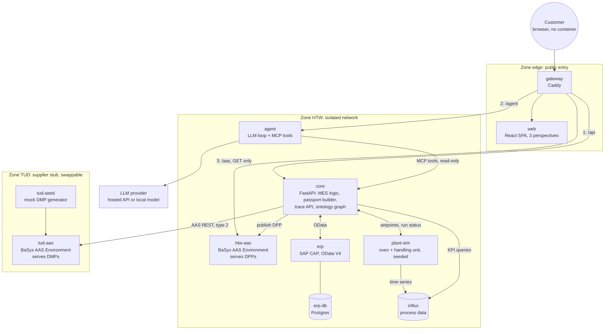
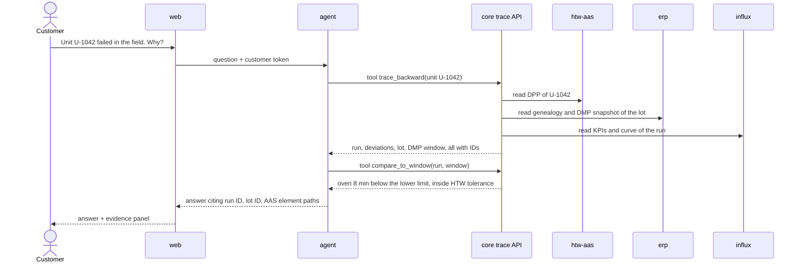

# Tech stack and deployment architecture: proposal

Status: draft v0.1 (2026-11-01), proposal for team discussion, nothing here is decided yet
Block: enabling blocks 3 to 6 and the data side of blocks 1 and 2, see `main-document.md`
Origin tags: as in `main-document.md` ([Task], [Slides], [05.10.], [14.10.], [Derived]), plus **[Proposal]** (our design choice, open to change) and **[Web]** (checked against a public source on 2026-11-01).

## 1. Summary

- Run the whole demonstrator as one Docker Compose project with three zones: **TUD** (supplier stub), **HTW** (producer, isolated network) and **edge** (the only public entry). [Proposal]
- The **customer is a role and a UI, not a container**. The HTW zone exposes an external-facing web UI and API; the customer works in a browser against it. [Proposal, from 14.10.]
- The **TUD zone is built as a stub**, but with the same interface a real TU endpoint would have. This is the fallback for Q6 and makes the HTW/TUD boundary real. [Proposal]
- **ERP is the system of record** for master data, lots, orders and genealogy. The AAS servers are a published, rebuildable view of it, not storage. This matches "AAS ist ein Datentransportstandard" [Slides]. [Proposal]
- The HTW zone also needs a **MES function** (not in the first sketch). It is where DMP data becomes a process window [Task G4a]. [Proposal]
- The AI agent is **read-only, role-scoped, and uses domain tools over MCP**. MCP is the tool interface, not the whole answer to Q5. [Proposal]

## 2. Design principles

1. **One boundary per institution.** TUD, HTW and customer talk over HTTP APIs only, never through a shared database. [Proposal]
2. **The contract is the AAS V3 REST API, not a product.** BaSyx today, the real TU endpoint or FA³ST tomorrow, with only a base URL changed. [Proposal]
3. **System of record per data class** (section 5). Anything derived (AAS content, ontology graph) can be rebuilt from ERP and Influx. [Proposal]
4. **Deterministic and resettable.** Seeded simulation, scenario files, one command to reset to a clean state. The failure story needs a known cause for testing the AI [Derived, block 4]. [Proposal]
5. **Role scoping lives in code, not in the prompt.** The agent can only see what the caller's role may see. [Proposal]
6. **Medium complexity first** [14.10.]. Every extra container needs a reason written down here. [Proposal]

## 3. Topology

### 3.1 Container decisions

| Zone | Decision | Reason |
|---|---|---|
| HTW | Containers, one per system (ERP, plant simulation, Influx, AAS server, core, agent) | Gives the "isolated system" and lets us show real system boundaries. [Proposal] |
| Customer | **No container.** A role with its own login and a restricted view in the web UI, optionally served under its own hostname | 14.10.: the HTW to customer communication is left out and the customer works directly on the data with the AI. There is no customer system to run. A container only pays off if the customer should hold their own AAS, which is out of scope. [14.10., Proposal] |
| TUD | **Yes, as a stub**: one AAS server plus a seed job that generates DMPs | Fallback for the unanswered TU request (Q6). Without it, "receive the DMP" would be a file read inside HTW and prove nothing. Cost is small. A real TU endpoint replaces it through one environment variable. [14.10., Proposal] |

Three perspectives without three systems [14.10.]: the same web build can be served under `tud.localhost`, `htw.localhost` and `customer.localhost`, each with its own role. [Proposal]

## 4. Components

| Service | Tech | Job | Origin |
|---|---|---|---|
| gateway | Caddy | Single entry, hostnames per perspective, `GET` only on `/aas`, TLS for a hosted demo | [Proposal] |
| web | React + TypeScript (Vite), React Flow for the chain view, ECharts for oven curves, chat panel with streaming | Supplier, producer and customer views. Visualizes information flows [Task G5] | [Proposal] |
| tud-aas | Eclipse BaSyx AAS Environment, in-memory storage | Serves DMPs. In-memory is enough because the seed job refills it at start | [Slides: BaSyx], [Proposal] |
| tud-seed | Python, BaSyx Python SDK, YAML/CSV input | Generates adhesive lots with DMPs. This is where "gemoggt" data lives | [14.10.], [Proposal] |
| core | Python 3.12, FastAPI, BaSyx Python SDK, httpx, influxdb client, rdflib | DMP import, process window, production runs, quality decision, DPP builder, trace API, flow-event log | [Task G4a], [Proposal] |
| erp | SAP CAP (Node.js), OData V4, Postgres | System of record. Full read and write via OData | [Slides: SAP OData], [Proposal] |
| plant-sim | Python, numpy, scenario YAML, fixed random seed | Oven and handling unit ("Jumi"). Fault cases from a standard deviation | [Slides], [14.10.] |
| influx | InfluxDB | Process data, tagged with lot, run and unit IDs | [Slides] |
| htw-aas | Eclipse BaSyx AAS Environment, MongoDB or in-memory | Serves HTW DPPs to the customer side | [Slides], [Proposal] |
| agent | Python, LLM provider adapter, MCP server (MCP Python SDK) | Chat, tool calls, answers with evidence | [Slides], [05.10.], [Proposal] |

Notes:

- BaSyx offers AAS Environment, AAS/Submodel Registry, AAS Discovery and an AASX File Server as ready components, targets AAS V3, and supports in-memory and MongoDB storage [Web: eclipse-basyx/basyx-java-server-sdk]. Start with the Environment only. Add Discovery when we need to find an AAS by lot ID. [Proposal]
- Why CAP for the ERP: a real OData V4 wire format (`$metadata`, `$filter`, `$expand`) is tedious to fake by hand. CAP generates it from a data model and runs on SQLite or Postgres [Web: cap.js.org]. If a real SAP endpoint becomes available (Q12), only base URL and auth change. [Proposal]
- Three languages (Python, Node for the ERP mock, TypeScript) is the price of that choice. If nobody in the team wants Node, the fallback is a FastAPI service with a reduced OData subset. [Proposal]

## 5. System of record

| Data | System of record | Other copies | Why |
|---|---|---|---|
| Materials, products, adhesive lots, production orders, runs, product units, genealogy (unit to run to lot) | **ERP** | Ontology graph (derived) | Single source for IDs and links, since DPPs are not coupled [14.10.] |
| Received DMP as it was at goods receipt | **ERP**, as an immutable snapshot with SHA-256 and receive time | TUD AAS (live, may change) | Tracing must show what HTW knew when it received the lot. The supplier can change or remove its passport later. [Proposal] |
| DMP values used by MES (temperature limits, cure time, humidity, storage) | **ERP**, copied into typed lot attributes at import | DMP snapshot | MES reads one trusted place [Task T9, T10] |
| Process time series | **Influx** | Run KPIs (min, max, mean, time outside window) written to ERP | Time series do not belong in ERP. ERP keeps the summary and the quality decision |
| HTW DPP | **Derived** from ERP and Influx KPIs | `htw-aas` is the published view | Rebuild with one command, never edit in the AAS server [Slides: AAS is transport, not storage] |
| Ontology graph | **Derived** | none | A query index for the agent, rebuilt from ERP, AAS and Influx KPIs |

## 6. Flows

### 6.1 Forward chain on the stack (block 1)

| Step in `forward-chain-process.md` | What happens |
|---|---|
| H2, T1 request | **Optional** (Q2). If in scope, `core` posts a MaterialRequest submodel to `tud-aas` |
| H3, H4 import DMP into ERP and MES | `core` fetches the DMP over AAS REST, stores snapshot and lot in the ERP (OData POST), copies key values into lot attributes |
| H5 derive process window, plan production | `core` creates the production order, derives setpoints and window from the lot attributes, sends setpoints to `plant-sim` |
| H6 to H8 heat, process, cure | `plant-sim` runs the scenario and writes time series to `influx` |
| H9, H10 collect data, quality check | `core` computes KPIs, compares them with the window and the HTW tolerance, writes the run result and decision to ERP (OData PATCH) |
| H11, H12 create and serve DPP | `core` builds the DPP from ERP and Influx KPIs and publishes it to `htw-aas` |

Every cross-system call also writes a **flow event** (who, to whom, what, ID). The web UI plays these events as the information-flow visualization [Task G5]. [Proposal]

### 6.2 Reverse chain: how the agent answers (block 2)

Illustrative numbers. The real deviation is a story decision (Q7).

## 7. AAS model sketch

Principles from the slides: reuse IDTA templates and ECLASS where they fit, keep each submodel independent, solve our problem first and abstract later [Slides].

| Passport | Submodels | Status |
|---|---|---|
| DMP (TUD, per adhesive lot) | Nameplate (IDTA 02006), Technical Data (IDTA 02003), **ProcessingWindow** (custom: temperature range, preheat, mixing, cure time and temperature, humidity limit, storage, pot life), **Traceability** (custom: origin, raw materials, pointer to the earlier supply chain [14.10.]), Carbon Footprint (IDTA 02023, only if Q3 says yes), Handover Documentation (IDTA 02004, optional) | Templates: [Web: industrialdigitaltwin.org/dpp4-0] |
| DPP (HTW, per product unit) | Nameplate, **MaterialInputs** (custom: supplier lot ID, DMP AAS ID as a plain reference plus snapshot hash, not a live link [14.10.]), **ProductionProcess** (custom: run ID, steps, KPIs per step, time outside window, quality decision), Carbon Footprint (optional) | Custom parts [Proposal] |

- The DPP4.0 page lists the templates above, and Recycling and End-of-Life (IDTA 02077) as "coming soon" [Web]. I did not see a ready material-passport template there, so check the IDTA content hub before building the custom ProcessingWindow submodel. [Proposal]
- Linking identifiers, because DPPs are not coupled: `supplierLotId`, `runId`, `unitId`. [Derived, 14.10.]
- AAS type: **type 2 (REST)** between TUD and HTW and from HTW to the customer UI. If the TU can only send files, **type 1** with AASX import into the server is the fallback. Type 3 is outlook only (Q4). [Slides, Proposal]
- Authoring: AAS Package Explorer for hand-built examples (the dummy AAS), BaSyx Python SDK for generating them. [Slides, Proposal]

## 8. Agent and tracing intelligence (Q5)

- **MCP is the tool interface, not the solution.** Tracing also needs the agent loop, a data model for relations, role scoping and a way to check answers. [Proposal]
- **Domain tools beat raw AAS access.** Expose `trace_backward(unit)`, `trace_forward(lot)`, `get_process_window(lot)`, `compare_to_window(run, window)`, `get_dpp(unit)`, each returning IDs and AAS element paths. A generic OpenAPI-to-MCP bridge for AAS exists (SAP/aas-mcp-server, Apache-2.0, read-only by default, but a small and early-stage project) [Web]. Good for exploring AAS data, but the model must then navigate raw AAS paths itself. [Proposal]
- **Ontology** (lot, process step, parameter, material property, defect, run, unit [Derived, block 5]) as an OWL/Turtle file in git, validated with SHACL. The instance graph is built from ERP, AAS and Influx KPIs. Start with rdflib inside `core`. Move to a triplestore container (Oxigraph or Fuseki) only if queries get slow or we want to show SPARQL live. [Proposal]
- **No vector RAG in v1.** The data is structured and keyed by IDs. Retrieval by graph and tools is more reliable and the answer can cite exact elements. Add RAG only if we include free-text documents such as datasheets. [Proposal]
- **Role scoping in `core`.** The customer token gets a redacted view (for example no supplier internals). The prompt is not the security boundary. [Proposal]
- **Evaluation.** A `pytest` suite with golden scenarios: given the seeded failure, the answer must name the planted cause and must not name the decoy deviations [Derived, block 4]. [Proposal]
- **LLM provider behind one interface.** A hosted API for answer quality, a local model (llama.cpp or Ollama) as an offline fallback for demo day. Expect weaker tool use from small local models, so run the golden suite against the fallback before relying on it. The data is synthetic, so a hosted API is not a data-protection problem, but confirm with the supervisors (Q15). [Proposal]

## 9. Deployment

| Item | Proposal |
|---|---|
| Orchestration | Docker Compose v2, one project, profiles `tud`, `htw`, `full`. No Kubernetes |
| Networks | `tud_net` (tud-aas, tud-seed), `htw_net` (all HTW services), `edge_net` (gateway, web). `core` joins `htw_net` and `tud_net` and is the **only** HTW service allowed to call TUD. `agent` reaches `core`, never ERP or Influx directly |
| Public ports | Only the gateway. ERP, Influx and both AAS servers are reachable only through it (debug ports behind a `debug` profile) |
| Swapping the supplier | `SUPPLIER_AAS_URL` points to `tud-aas` by default, or to the real TU endpoint. Start without the `tud` profile when the real one exists |
| Reset | `make reset SCENARIO=<name>` clears ERP, Influx and both AAS servers, reseeds, and replays the scenario with its fixed seed |
| Scenarios | YAML files: `baseline`, `decoy-deviations`, `root-cause-field-failure`. One file defines the lot, the deviations and the expected finding |
| Repo and CI | GitLab [Slides]. Monorepo with a folder per service and `docs/`. CI: lint, tests, golden agent tests, image build. A GitLab container registry only if the HTW instance offers one (Q14) |
| Hosting | Default: everything on a team laptop, no network needed. Option: a VM with Caddy for a shareable customer link, if HTW provides one or we pay for a small one (Q14) |
| Demo app form | **Web application** (Q10). The external-facing HTW UI and the customer role need it anyway |

Footprint: the two BaSyx environments are the heaviest part. Check RAM on the weakest team laptop early. [Proposal]

## 10. Phases

| Phase | Result | Note |
|---|---|---|
| 0, due 9 Nov | Technology map (sections 3 and 4 of this file), one **dummy DMP** built in AAS Package Explorer, loaded into a single BaSyx container, read via REST | Covers the open TODOs from Martin Schmidt: read the paper, visualize the process, visualize the technologies, build a dummy AAS |
| 1 | Walking skeleton: `tud-seed` and `tud-aas`, `core` fetches a DMP and stores lot and snapshot in `erp` over OData | Proves the three hardest interfaces early: AAS REST, OData, Compose networks |
| 2 | `plant-sim`, `influx`, window check, quality decision, DPP published to `htw-aas` | Forward chain complete |
| 3 | Ontology graph, MCP tools, agent, customer view, golden tests | Reverse chain complete |
| 4 | Scenario polish, flow-event visualization, demo script, outlook on higher complexity (more tiers, DPP coupling, a dataspace connector) | [14.10.] |

## 11. Risks

| Risk | Mitigation |
|---|---|
| TU data does not arrive | Stub zone with the same interface (section 3.1). Ask Paul for the TU data format and whether they offer an AAS REST endpoint or only AASX files (Q13) |
| "Jumi" is unclear (glossary, open point 1) | `plant-sim` hides it behind a handling-unit interface with pick, place, dwell events. Replace once clarified |
| No SAP access, but "SAP OData" is a stated focus | CAP mock now. Ask whether a real SAP endpoint exists (Q12) |
| The LLM gives unreliable answers or the venue network fails | Golden tests, seeded scenarios, local fallback model, recorded answer cache for the demo |
| Team skill spread over Python, Node, TypeScript, BaSyx | One owner per service, shared Compose project, walking skeleton first so everybody sees the interfaces |
| Over-building | Medium complexity only [14.10.]. Registry, Discovery, triplestore, MQTT/OPC UA and auth server are optional and added only with a written reason |

## 12. Open questions

These continue the list in `main-document.md`.

| ID | Question | Block | Suggested decider |
|---|---|---|---|
| Q12 | Is a real SAP system with OData available (the slides show the ERP on the supplier side, with "SAP OData" as a focus area)? Or do we mock OData ourselves? | 4 | Supervisors |
| Q13 | Does the TU expose its DMPs through an AAS REST API, or only as AASX files? | 3, 4 | Paul, team |
| Q14 | Where does the demo run: team laptop only, an HTW VM, or a hosted VM? Does the HTW GitLab provide a container registry? | 6 | Supervisors, team |
| Q15 | May the AI chatbot use a hosted LLM API with synthetic data, or is local inference required? | 5 | Supervisors |

This proposal also gives a recommended answer to existing questions: **Q2** optional, planned as a stretch step. **Q4** type 2 with an AASX import fallback, BaSyx as runtime. **Q5** MCP as tool interface with domain tools, plus the pieces in section 8. **Q6** the TUD stub. **Q10** web application.

## 13. Change log

- 2026-11-01: v0.1, first proposal
